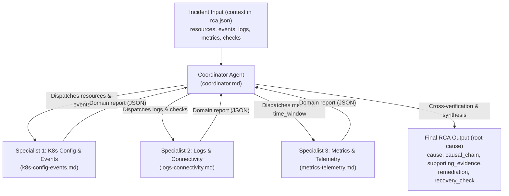

# Multi-Agent System (MAS) Prompts for Kubernetes RCA

This directory contains the prompt definitions for the **Multi-Agent AI Architecture** evaluated in the course project for **Root Cause Analysis (RCA)** in Kubernetes.

The multi-agent system investigates incidents reproduced from the 15 benchmark scenarios in [`proj/examples/`](../../examples.md), diagnosing operational failures from raw telemetry and manifest configurations without human intervention.

---

## 1. Multi-Agent Architecture

The architecture partitions the diagnostic workflow into domain-specific investigation tasks overseen by an incident coordinator:



---

## 2. Prompt Inventory

| File | Agent Role | Focus Domain & Specialization |
| --- | --- | --- |
| [`coordinator.md`](./coordinator.md) | **Lead Incident Commander & Synthesizer** | Orchestrates the investigation, correlates domain findings, resolves conflicting symptoms (e.g., distinguishing symptoms like `CrashLoopBackOff` from root causes), and outputs the final `root-cause` JSON. |
| [`k8s-config-events.md`](./k8s-config-events.md) | **K8s Configuration & Events Specialist** | Audits workload manifests, resource requests/limits, probe paths/budgets, Service selectors, target ports, RBAC verbs, NetworkPolicy rules, and cluster events (`OOMKilling`, `FailedScheduling`, `Unhealthy`). |
| [`logs-connectivity.md`](./logs-connectivity.md) | **Logs & Connectivity Specialist** | Analyzes stdout/stderr logs (current and pre-crash), memory allocation progression, startup phases, dependency errors, DNS resolution, and TCP/probe checks. |
| [`metrics-telemetry.md`](./metrics-telemetry.md) | **Metrics & Telemetry Specialist** | Evaluates Prometheus time series, container memory cgroup saturation, CPU throttling periods, node capacity limits, and timestamp alignment across observation windows. |

---

## 3. Prompt Design Methodology

All prompts strictly follow the **6-component prompt architecture**:
1. **Persona/Role:** Defines the specific diagnostic domain, authority, and perspective.
2. **Context/State:** Delineates input boundaries, strictly enforcing that empty lists (`[]`) represent uncollected observations rather than measured zeroes.
3. **Instructions/Tasks:** Step-by-step diagnostic procedures mapped directly to Kubernetes operational failure modes (covering all 15 scenarios in `proj/examples/`).
4. **Constraints:** Eliminates hallucinations, prohibits superficial status-level diagnoses, and enforces strict JSON output contracts.
5. **Few-shot Examples:** Illustrates domain-specific inputs and expected reasoning.
6. **Expected Format of Output:** Machine-parseable JSON schemas ensuring seamless inter-agent communication and benchmark validation.

---

## 4. Benchmark Evaluation & Ground Truth Contract

The final output produced by `coordinator.md` strictly mirrors the evaluator-only `root-cause` schema defined across all 15 cases in `proj/examples/*/rca.json`:

```json
{
  "cause": "Specific fault and affected resource or configuration field",
  "causal_chain": "How the fault produces the observed problem",
  "supporting_evidence": [
    "Observable fact 1",
    "Negative proof / excluded alternative 2"
  ],
  "remediation": "Recommended correction",
  "recovery_check": "Observable condition confirming recovery"
}
```
